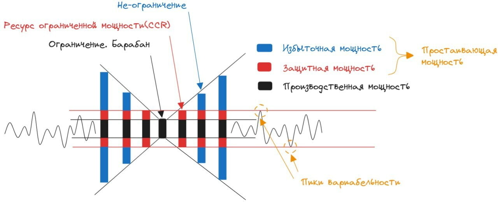

# Защитная мощность и безопасность

Автор — Иван Абашкин.

Первая версия в Telegram — [2025-02-07](https://t.me/ivan_abashkin/232).

Продолжение первой версии — [Telegram](https://t.me/ivan_abashkin/234).

Публикация на VC.ru — [2025-02-07](https://vc.ru/transport/1798346-zashitnaya-moshnost-i-bezopasnost).

Дата переноса в архив — 2026-11-13.

Недавняя катастрофа Embraer E190 под Актау (AZAL) заставила рекомендательную систему Youtube подкидывать мне в ленту ролики об авиационных происшествиях. Ну и я, признаюсь, залип. Просмотрел множество расследований и невольно примерял свой менеджерский опыт и знания Теории Ограничений (ТОС) к каждой ситуации. Как говорится, если у тебя в руках молоток, всё вокруг кажется гвоздями.

И вот что интересно: многие катастрофы, если смотреть на них через призму ТОС, происходят из-за того, что система потеряла защитную мощность. В любой системе есть непредсказуемые колебания, отклонения от нормы – вариабельность. Обычно система с ними справляется. Но если защитной мощности недостаточно, то стечение нескольких даже не самых серьезных неприятностей может привести к катастрофе. Как будто несколько маленьких волн, наложившись друг на друга, превращаются в цунами.

## Что такое защитная мощность?

ТОС учит нас, что в любом процессе – будь то производство, поставки или управление проектами – должна быть защитная мощность. Это не просто "запас на всякий случай", а специально выделенный ресурс, который позволяет системе справляться с неизбежными сбоями и колебаниями.

- **На производстве:** Производительность системы в идеале определяется ресурсом-ограничением ("барабаном"). Но из-за вариабельности любой ресурс с ограниченной мощностью (РОМ) может временно стать "узким местом". Поэтому у всех ресурсов, кроме "барабана", должна быть защитная мощность – запас, позволяющий "подстраховать" систему при сбоях, включая сбои на самом РОМ. Избыточная мощность – это то, что остается сверх защитной. Но даже "барабан" не должен работать на 100% – ему нужен запас для обслуживания.
- **В проектах:** Защитная мощность проявляется в виде буферов времени, добавленных в критическую цепь (последовательность работ, определяющую длительность проекта). Этот буфер – не "лишнее" время, а ресурс, который позволяет проекту не сорваться из-за непредвиденных задержек.
- **В авиации** (и не только): Два двигателя вместо одного, три датчика скорости вместо одного, дублирование и троирование систем – всё это примеры защитной мощности. Это не просто "перестраховка", а жизненно важный ресурс, который спасает в критических ситуациях.

## Когда не хватает защитной мощности

Катастрофа – это результат стечения нескольких редких событий, каждое из которых само по себе могло бы и не привести к трагедии. Когда они накладываются друг на друга, а защитной мощности не хватает, случается беда.

### Примеры из авиации:

- **Отказ обоих двигателей.** Редкая ситуация, но именно для неё и нужна защитная мощность: резервные системы управления, планирование на случай отказа, тренировки экипажа. Если этих мер недостаточно или они проигнорированы (например, экипаж не отработал действия в такой ситуации), отказ двигателей приводит к катастрофе.
- **Отказ всех трех датчиков скорости.** Ещё более невероятно, но и здесь важна защитная мощность: резервные приборы, дублирующие системы, возможность пилотирования по другим параметрам. Катастрофа происходит, если экипаж оказывается не готов к такому развитию событий из-за нехватки тренировок (защитная мощность в виде навыков) или из-за отказа дублирующих систем (защитная мощность в виде оборудования).
- **Экономия топлива.** В этом случае авиакомпания сознательно уменьшает защитную мощность (запас топлива), повышая риск. Пилот, ограниченный в топливе, может быть вынужден отказаться от ухода на второй круг, даже если это необходимо.

### Пример из жизни: вождение автомобиля

Вряд ли среди моих читателей много пилотов, поэтому давайте рассмотрим более близкий пример – вождение автомобиля.

Чтобы попасть в ДТП, вы тоже должны "лишиться" защитной мощности:

- **Несоблюдение дистанции.** Это уменьшает вашу защитную мощность в виде времени на реакцию. Если впереди идущий автомобиль резко затормозит, у вас будет меньше времени, чтобы избежать столкновения.
- **Управление одной рукой.** Это уменьшает вашу защитную мощность в виде контроля над автомобилем. При пробое колеса или попадании в яму может не хватить сил, чтобы удержать машину на дороге.
- **Превышение скорости.** Это сокращает и защитную мощность в виде времени, и защитную мощность в виде пространства для маневра. У вас будет меньше времени на оценку ситуации и меньше места для торможения или объезда препятствия.
- **Телефон за рулем.** Даже если дорога кажется пустой, вы лишаете себя защитной мощности в виде внимания. Наезд на яму, внезапно появившийся пешеход, неожиданный маневр другого водителя – все это может привести к аварии, если вы отвлечены.

## Опасность "оптимизации"

Горе-оптимизаторы, стремясь повысить КПД, часто начинают "резать косты" – убирать то, что кажется лишним. Но они не задумываются о последствиях. С каждым "отрезанным куском" система теряет надежность, а не просто ресурсы или защитную мощность. Анализ системы не проводится, реальная вариабельность не учитывается. Система становится все более уязвимой, пока в один "прекрасный" момент её не пробьет.

### Суть безопасности – защита от неожиданностей

Ваша система (самолет, автомобиль, рабочий процесс) должна быть защищена от редких, но разрушительных событий. Но защита – это не только "толщина брони". Это ещё и умение предвидеть, и наличие достаточной защитной мощности. Защита – это не просто избыток ресурсов ("страховка"), но и осознанный подход к любым изменениям.

Прежде чем что-то "оптимизировать" или менять в системе, нужно тщательно проанализировать:

- К**акие "волны" вариабельности (отклонений от нормы) могут возникнуть в этом месте?** Речь не только о привычных показателях (литры, километры, штуки). Это может быть и давление в трубе, и температура, и усталость персонала – всё, что может колебаться.
- Насколько сильными могут быть эти "волны"? Каков максимальный уровень отклонения, который мы можем ожидать?
- Не создаст ли наше изменение "слабое звено"? Не получится ли так, что, улучшая одно, мы ослабим другое? Не станет ли система более уязвимой к какому-то виду "волн"? Не получится ли так, что "лекарство" окажется хуже болезни?

Другими словами, любое изменение – это "инъекция" в систему. И, как в медицине, у этой "инъекции" могут быть побочные эффекты. Наша задача – не просто "вколоть" решение, а предусмотреть и "отсечь" возможные негативные последствия. В Теории Ограничений для этого есть специальный подход (NBR): прежде чем что-то менять, подумай, что может пойти не так, и подстрахуйся.

### Проход важнее КПД

Часто производительность системы определяется не КПД, а её проходом – способностью достичь поставленной цели. Ваш автомобиль оценивается не по расходу топлива, а по тому, довезет ли он вас до пункта назначения, и с каким комфортом.

Возможно, вашу систему не нужно оптимизировать. Возможно, её нужно направлять к достижению более высоких результатов, обеспечивая достаточную защитную мощность, пусть даже ценой больших кажущихся затрат. Авиакомпаниям, возможно, стоит больше думать о безопасности, а не о снижении расходов. Эффект катастрофы отразится не только на пассажирах, но и на самой компании (репутационные и финансовые потери), и даже на государстве (снижение доверия к отрасли, экономические последствия).

*P.S. Создавайте защитную мощность за рулём. Не пытайтесь "оптимизировать" ваше время в пути. Лучше доехать до цели, чем "эффективно" отправиться на тот свет.*
