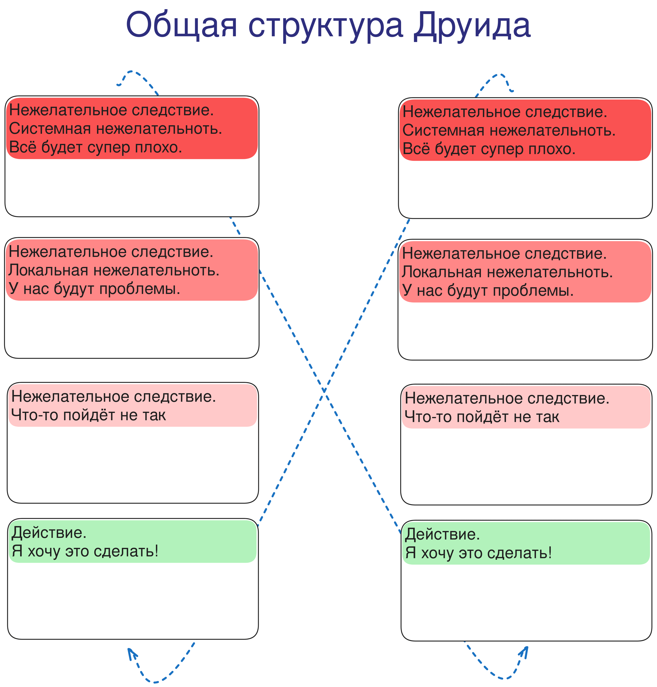
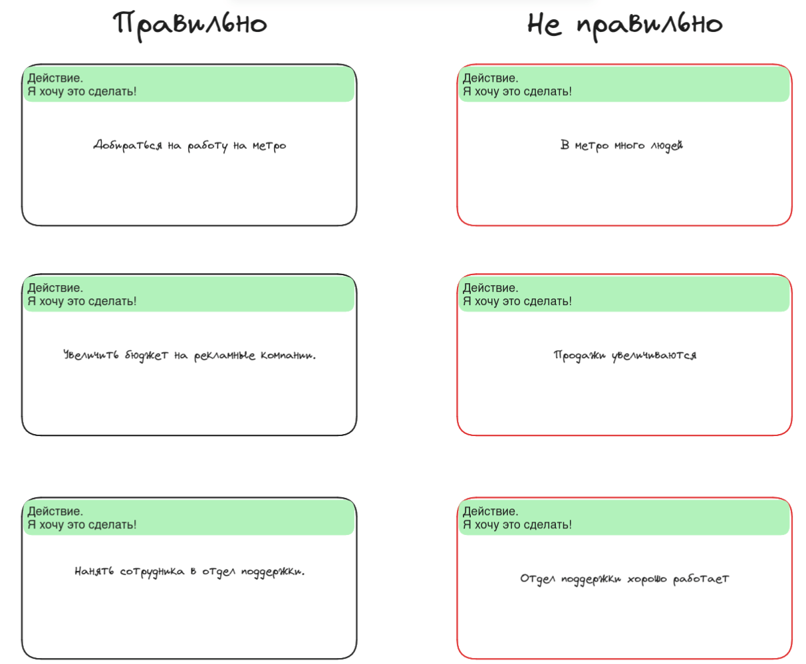
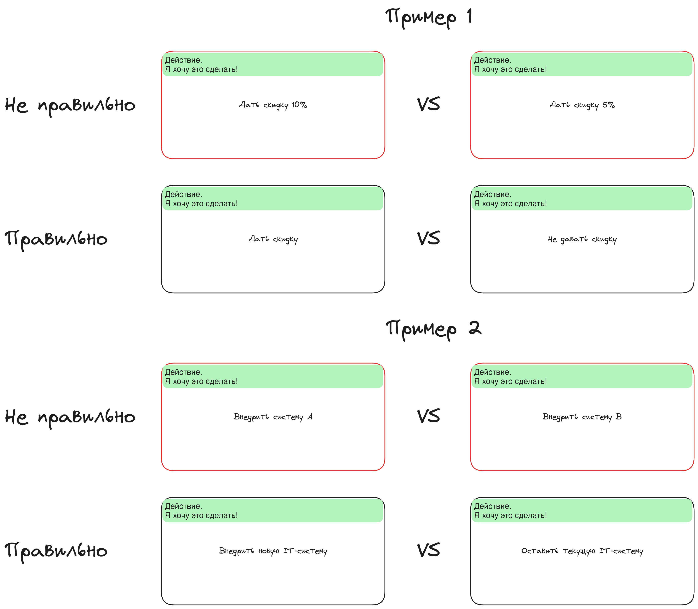
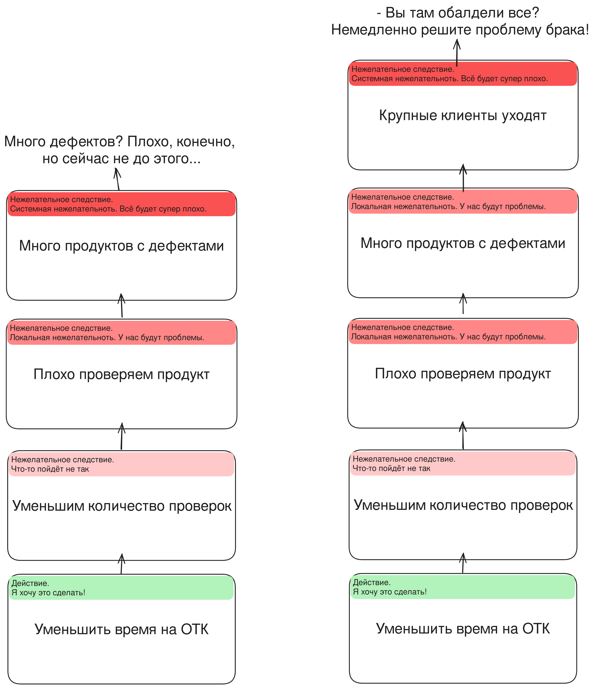
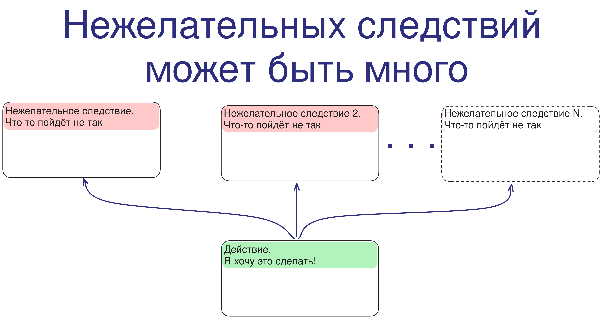
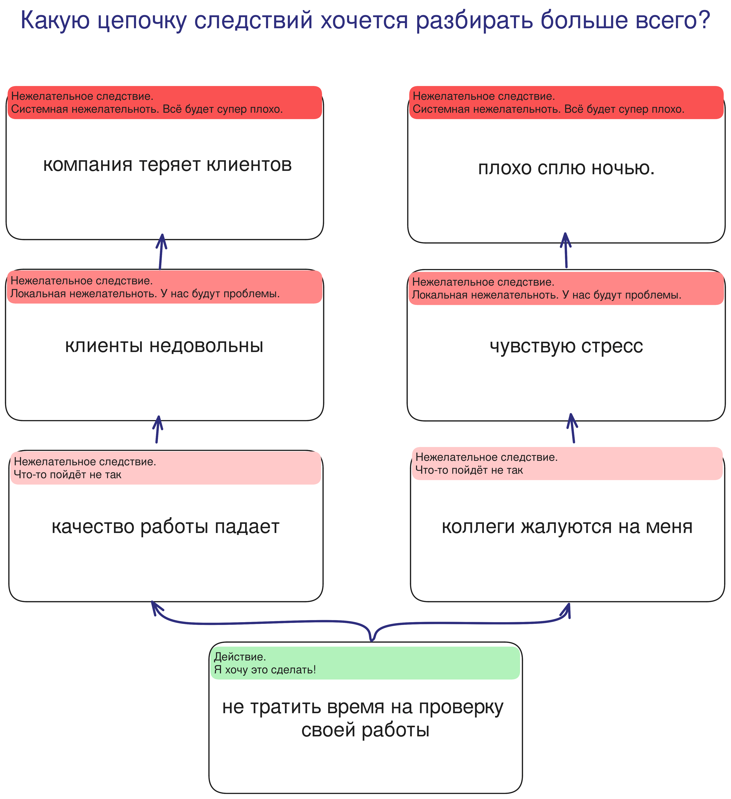
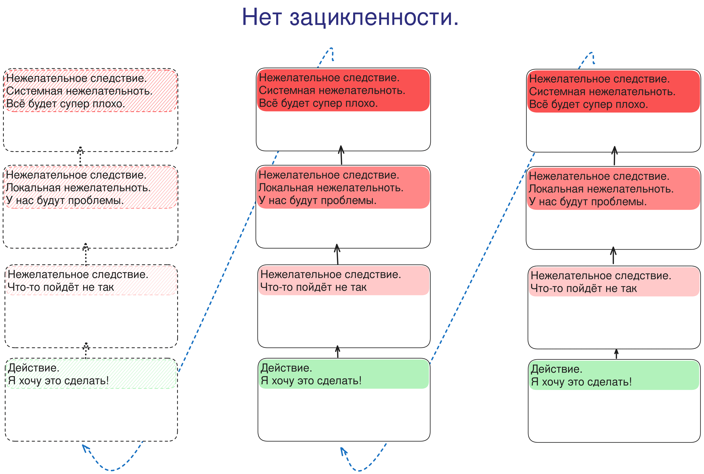
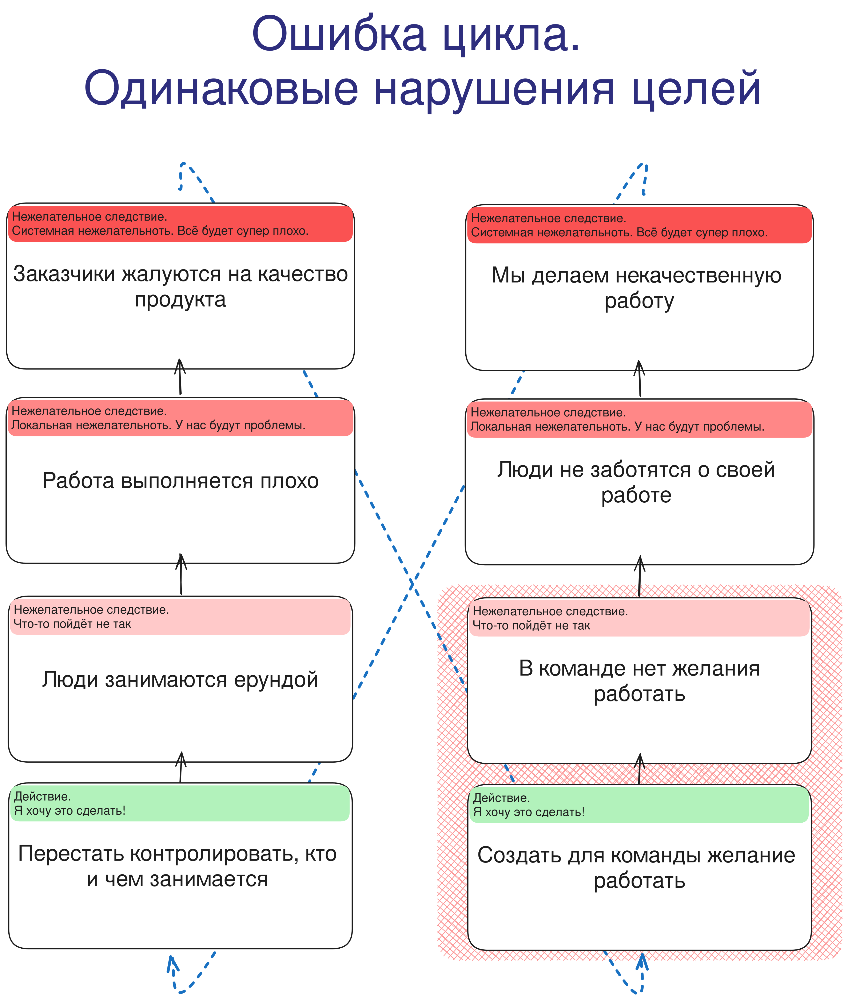
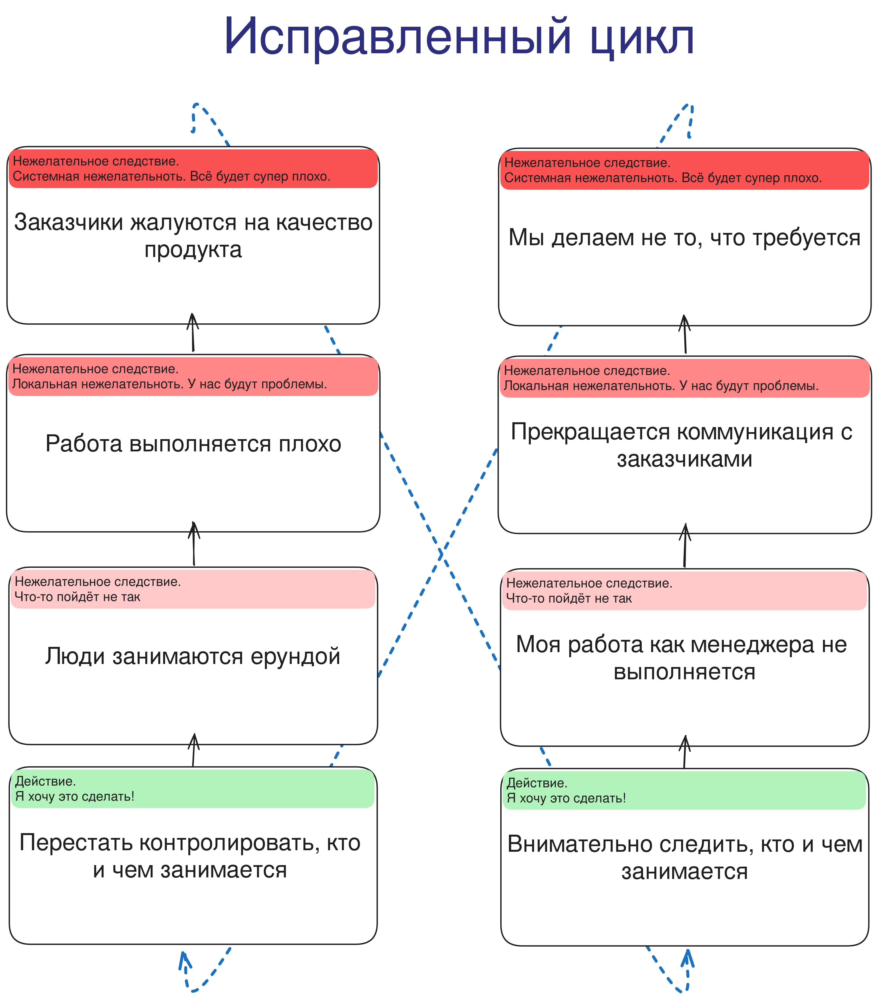

# Типичные ошибки при составлении Волшебных Друидов

Автор — Иван Абашкин.

Публикация на VC.ru — [2024-03-26](https://vc.ru/id2954042/1094648-tipichnye-oshibki-pri-sostavlenii-volshebnyh-druidov).

Первоначальное руководство — [Волшебный Друид](Прокачай%20системное%20мышление%20Волшебный%20Друид%20-%20новый%20инструмент%20мыслительных%20процессов%20Теории%20Ограничений.md).

Дата переноса в архив — 2026-11-13.

## Введение

Волшебный Друид — мощный инструмент для анализа и разрешения противоречий. Он помогает выявить корневую проблему, скрытую за конфликтующими действиями, и найти решение, которое ранее было неочевидно. Подробнее о том, как работает этот инструмент, вы можете прочитать в моей предыдущей <a href="https://vc.ru/life/1046937-prokachay-sistemnoe-myshlenie-volshebnyy-druid-novyy-instrument-myslitelnyh-processov-teorii-ogranicheniy" rel="noopener" target="_blank">статье</a>.

Друид — это не сложный инструмент, но при его использовании можно допустить ряд ошибок, которые могут значительно затруднить решение проблемы или даже увести нас в другую сторону, заставив зря потратить силы.

В этой статье я расскажу, на что стоит обратить внимание и как избежать распространенных ловушек и слабых мест, подстерегающих при построении Друидов. Проработав материал, вы научитесь описывать сильные, обоснованные противоречия, которые помогут решать ранее неприступные задачи, лучше коммуницировать с коллегами и, в конечном счете, быстро принимать более качественные решения.

## Основание Друида — это действие

В нижней части каждого столбика Друида должно находиться действие. Это нечто, что кто-то активно делает или желает сделать. Это всегда какое-то вынужденное действие, мы должны его сделать, чтобы предупредить большую беду.

Часто в нижних блоках Друидов встречаются формулировки в виде оформленного результата, чего-то, что должно произойти в будущем или следствия каких-то предыдущих действий. Это некорректно, нужно избегать подобных формулировок в нижнем блоке.

**Неправильно:**

1.  В метро много людей (констатация факта или нежелательность, тут нет действия).
2.  Продажи увеличиваются (ожидаемый результат, отсутствие действия).
3.  Отдел поддержки хорошо работает (ожидаемый результат, отсутствие действия).

**Правильно:**

1.  Добираться на работу на метро.
2.  Увеличить бюджет на рекламные кампании.
3.  Нанять сотрудника в отдел поддержки.

**Как проверить:**

- Текст внутри нижних блоков Друида должен отвечать на вопрос: "Что сделать? /Что делать?".
- Попробуйте продолжить фразу: «Чтобы решить проблему, мы должны делать…» Подходит ли текст в блоке как продолжение этой фразы?

## Два нижних блока действий в Друиде должны быть противоположны друг другу

Друид — это инструмент для визуализации **противоречий**. Это значит, что мы не можем делать и то, и другое действие одновременно. Если Друид сформулирован верно, то в основании обоих столбиков Друида будут находиться действия, которые невозможно выполнить одновременно. Язык не всегда даёт возможность сформулировать совершенно противоположные действия. Существует некоторый градиент в степени противопоставления одного действия другому. В идеале мы должны получить формулировки, которые строго противоречат друг другу: «Идти направо» против «Идти налево». Но на практике настолько явное противоречие не всегда получается сформулировать. Мы можем написать что-то вроде: «Идти направо» против «Обходить сбоку». Чем больше наши действия противоречат друг другу, чем больше они похожи на разные полюса магнита, тем лучше.

**Плохо:**

1.  «Дать скидку 10%» против «Дать скидку 5%».
2.  «Внедрить систему А» против «Внедрить систему B».
3.  «Отложить задачу на день» против «Отложить задачу на неделю».

**Хорошо:**

1.  «Дать скидку» против «Не давать скидку».
2.  «Внедрить новую IT-систему» против «Оставить текущую IT-систему».
3.  «Выполнить задачу сейчас» против «Отказаться от задачи».

**Как проверить:**

- Убедитесь, что между двумя формулировками действий в Друиде существует значительная «разность потенциалов». Чем больше эта «разность потенциалов», чем больше два действия содержат противоположности друг с другом, тем более сильное противоречие мы рассматриваем и тем более сильное решение получится в итоге.
- Убедитесь, что противоречие действительно существует. Для этого попробуйте перечислить конкретные причины, по которым мы не можем выполнить два действия одновременно, используя следующую формулу: «Действие 1 и Действие 2 невозможно осуществить одновременно, потому что: … \<перечислите причины по пунктам\> …»

## Проверка на значимость системной нежелательности

Верхний блок в каждой цепочке Друида должен содержать серьёзный нежелательный эффект, влияющий на нашу систему. Это что-то важное и значимое для нас, что ставится под угрозу действием в нижней части столбика Друида.

**Плохо:**

1.  «Низкий контроль качества продукции»
2.  «Сотрудники игнорируют технику безопасности»
3.  «Заказы выполняются с задержками»

**Хорошо:**

1.  «Теряем крупных клиентов» (из-за брака продукции)
2.  «Жизнь работников под угрозой» (из-за нарушения правил безопасности)
3.  «Плохая репутация на рынке» (из-за изношенного оборудования)

Попробуйте задать себе вопрос: «Я могу игнорировать эту проблему?«, если ответ »нет, ни в коем случае», то всё сформулировано верно.

Например:

**Уменьшить время на ОТК --\> Уменьшим количество проверок --\> Плохо проверяем продукт --\> много продуктов с дефектами**

Само по себе наличие дефектных продуктов может не мотивировать нас на какие-то действия: «Ну много дефектов, ну и что …»

Давайте попробуем развить эту мысль дальше:

**Уменьшить время на ОТК --\> Уменьшим количество проверок --\> Плохо проверяем продукт --\> много продуктов с дефектами --\> крупные клиенты уходят**

Потеря крупных клиентов — заставит нас всерьез задуматься об усилении контроля качества продукции.

Помните, что форма Друида с двумя промежуточными блоками это рекомендация, а не требование. Если вы чувствуете, желание развить негативные последствия у цепочки — не стоит себя останавливать требованием уместиться в четыре блока. Чем более серьёзный негативный эффект вы сможете выделить, тем более серьёзную потребность вы сможете сформулировать.

После того, как цепочка от действия к значительному нежелательному явлению будет сформулирована вы можете вырезать незначительные промежуточные шаги соединив оставшиеся блоки напрямую. Это позволит разгрузить структуру друида и мыслить яснее.

## Уход в сторону от основной проблемы.

При построении друида важно сохранять фокус на ключевой проблеме, которую вы хотите решить. Иногда промежуточные этапы друида могут увести вас в сторону от основной темы, и в результате верхний блок (нарушение цели системы) окажется не связанным с исходной проблемой.

Промежуточные этапы друида должны объяснять, как одно следствие вытекает из другого, приводя к нарушению цели системы. Однако из одного нежелательного следствия может проистекать несколько различных проблем. В таких случаях необходимо сосредоточиться на той проблеме, которую вы действительно хотите решить.

Пример 1:

1.  **Не тратить время на проверку своей работы --\> качество работы падает --\> клиенты недовольны --\> компания теряет клиентов**
2.  **Не тратить время на проверку своей работы --\> коллеги жалуются на меня --\> чувствую стресс --\> плохо сплю ночью.**

Пример 2:

1.  **Делать частые перерывы в работе --\> задачи делаются дольше --\> проекты делаются дольше --\> мы делаем проекты медленнее конкурентов**
2.  **Делать частые перерывы в работе --\> нарушается концентрация внимания --\> я допускаю ошибки --\> коллеги жалуются на мой код**

Пример 3:

- **Усилить контроля качества --\> увеличивается время на выполнение работы --\> проекты сдаются позже срока --\> компания платит штрафы за просрочку.**
- **Усилить контроля качества --\> коллеги чувствуют давление --\> моральный климат в команде ухудшается --\> увеличивается текучка кадров.**

При составлении, формулировании Друида, обратите внимание, есть ли у вас ветвление при формулировании нежелательноcтей. Если вы видите несколько негативных следствий, то решите для себя какое из них для вас является наиболее важным именно сейчас. Какому негативному следствию вы хотели бы уделить больше внимания? Сосредоточьтесь на том, что действительно важно для вашей ситуации, и сконцентрируйтесь на чем-то одном. При желании, побочные ветки можно будет рассмотреть позже, составив для них отдельных Друидов.

## Проверка на замкнутость

Друид представляет собой замкнутую петлю, в которой нарушение цели системы на одной стороне вынуждает нас предпринять действие, лежащее в основании другой стороны. Это создает постоянный цикл, где мы переходим от одного решения к другому, но ни одно из них не устраняет проблему в долгосрочной перспективе.

Когда обе ветки Друида сформированы, убедитесь в том, что они замыкаются друг на друга.

Часто встречается ситуация, когда мы сбиваемся в рассуждениях, и системная нежелательность из второй ветки Друида не вызывает действия, лежащего в основе первой ветки. Вместо этого она побуждает нас совершать какое-то третье действие.

Если же замыкания не происходит, пересмотрите цепочку негативных следствий от каждого действия. Возможно, в какой-то момент вы ушли в сторону (смотрите предыдущий раздел).

Вот два вопроса, которые нужно задать себе, чтобы убедиться, что замкнутость сформулирована верно:

- "Действительно ли действие 1 ставит под угрозу системную нежелательность 8?"
- "Действительно ли действие 5 ставит под угрозу системную нежелательность 4?"

Замкнутость цикла указывает на то, что вы уловили истинную суть противоречия. Отсутствие замкнутости — признак ухода в сторону при рассуждениях о проблеме. Без выявления противоречия решить её будет крайне сложно.

## Избегайте ложной зацикленности

Иногда при составлении друида мы можем зациклиться на одном и том же. Тогда две половинки друида станут почти одинаковыми. В этот момент они перестают проявлять конфликт и начинают водить ваши размышления по замкнутому кругу.

В примере ниже вы можете увидеть, как это бывает. Обе стороны друида крутятся вокруг одной и той же мысли, не выявляя и не подсвечивая противоречие в действиях:

- **--\> Перестать контролировать, кто и чем занимается -\> люди занимаются ерундой --\> работа выполняется плохо --\> заказчики жалуются на качество продукта --\>**
- \-**-\> Создать для команды желание работать --\> в команде нет желания работать -\> люди не заботятся о своей работе --\> мы делаем некачественную работу--\>**

Нарушенные потребности у этого друида получились одинаковые, просто сформулированы разными словами: «мы делаем некачественную работу« и »заказчики жалуются на качество продукта».

Эта ошибка началась с цепочки рассуждений:

- **Создать для команды желание работать -\> в команде нет желания работать**

Обратите внимание, что утверждение «в команде нет желания работать» безусловно описывает неприятную ситуацию, но разве она вытекает из нашего стремления создать это желание? Нет. Это замкнутый круг, тавтология.

Бороться с такого рода ошибками бывает довольно сложно. Вот несколько рекомендаций, чтобы их избежать:

- Обсудите получившегося друида с кем-нибудь ещё. Пускай кто-то свежим взглядом посмотрит на логику, задаст вопросы, предоставит критику вашим формулировкам.
- Старайтесь избегать обвинений.
- Оперируйте наблюдаемыми фактами, а не желаниями или требованиями.
- Старайтесь быть предельно конкретными.
- Проверьте наличие противоречия в действиях 1 и 5. Попробуйте изменить формулировки в этих блоках, чтобы острее показать противоречие.

Исправленный друид из примера выше мог бы выглядеть как-то так:

- **--\> Перестать контролировать, кто и чем занимается -\> сотрудники простаивают --\> мы не успеваем проверить работу -\> заказчики жалуются на качество продукта --\>**
- **--\> Внимательно следить, кто и чем занимается --\> моя работа как менеджера не выполняется --\> прекращается коммуникация с заказчиками --\> мы делаем не то, что требуется --\>**

## Заключение

Для верного принятия решений и глубокого понимания проблемы необходим сильный друид. Слабый друид может ввести в заблуждение и потратить ваше время и мыслительные ресурсы впустую. Качественный друид обеспечивает глубокое понимание конфликта, создавая фундамент для поиска решения. Он также служит основой для конструктивного обсуждения ситуации с другими заинтересованными лицами.

Вложенные усилия в создание валидных друидов окупятся сторицей, позволив решить ранее неразрешимые проблемы.

## Источники:

- Материалы и опыт <a href="https://t.me/fundamentalassumptions" rel="nofollow noopener" target="_blank">Андрея Пчелинцева</a> полученные на тренинге <a href="https://blackbeltinthinking.com/courses/" rel="nofollow noopener" target="_blank">BBIT</a>
- Мой личный опыт работы с инструментом
- Критерии Проверки Логических Построений (<a href="https://bipulse.ru/app/dictionary/docs/categories%20of%20legitimate%20reservation" rel="nofollow noopener" target="_blank">categories of legitimate reservation</a>) из книги "<a href="https://www.litres.ru/book/uilyam-detmer/teoriya-ogranicheniy-goldratta-sistemnyy-podhod-k-nepreryvno-6136463/" rel="nofollow noopener" target="_blank">Теория Ограничений Голдратта</a>", написанная Вильямом Детмером
